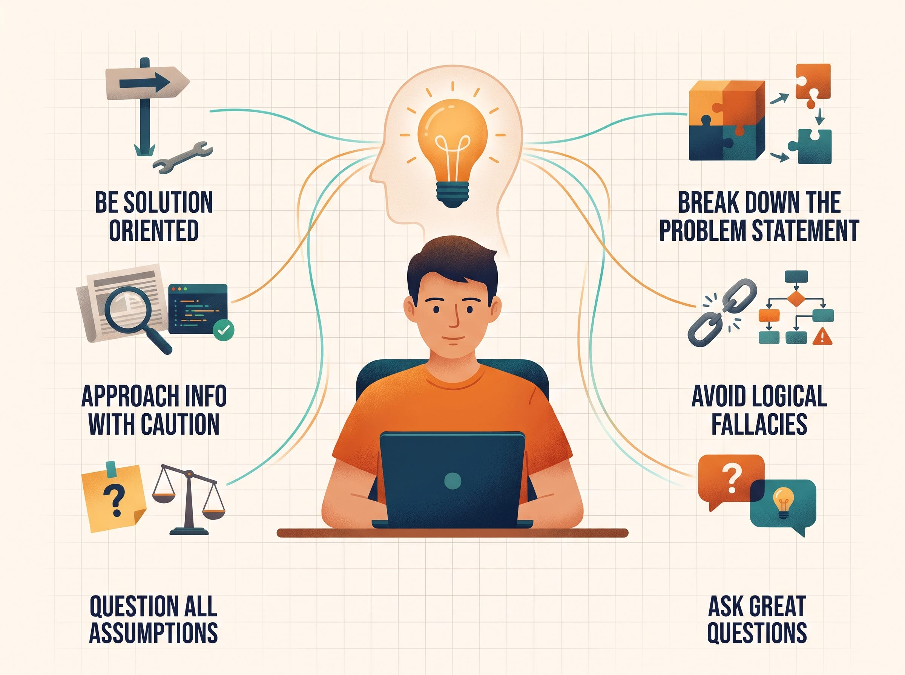
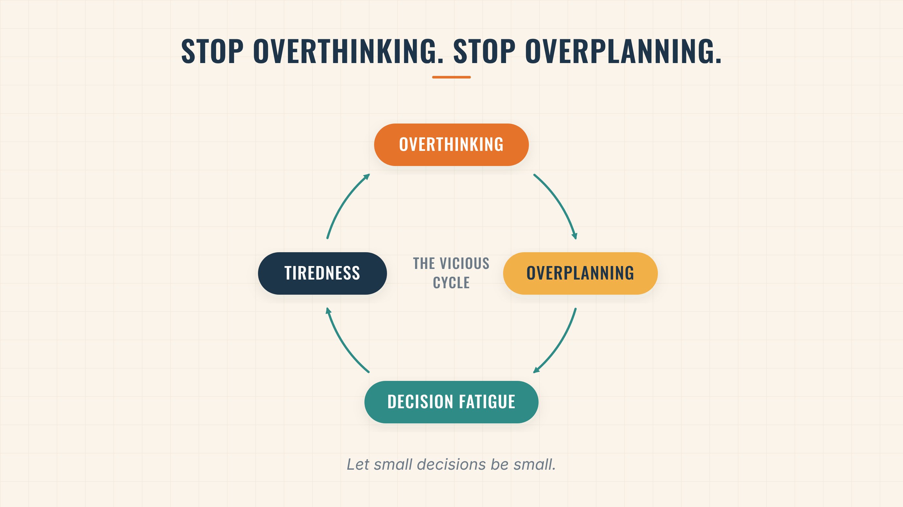
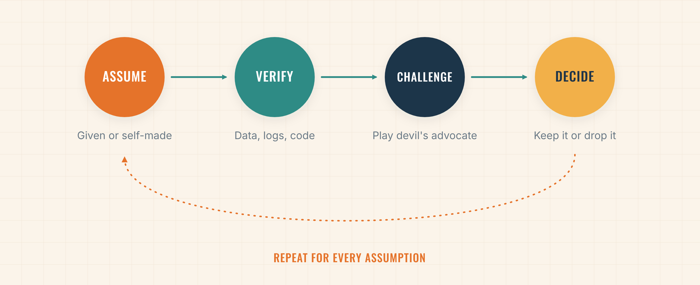
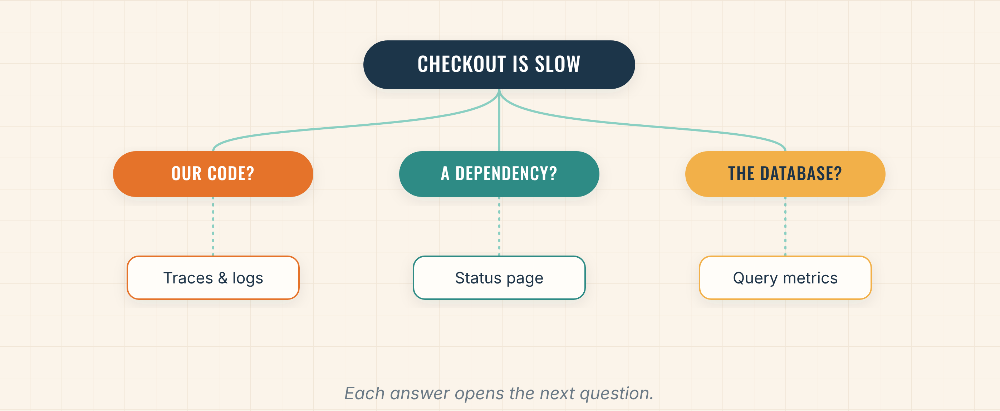

Critical thinking is fading. Social media algorithms feed us whatever keeps us scrolling, and ever since short-form content took over Instagram and YouTube, our attention spans and our patience for deep thought have been shrinking. Now AI is adding to the problem. Its answers and summaries are quick and effortless, so we often trust them without question and let them do our thinking. Each one is a small dopamine hit, and it’s changing how we work: we skim instead of digging, accept the first answer, and skip the thinking that good engineering depends on.

In my previous Medium article, [How to Work Better with AI](https://medium.com/@jay.parekh7689/how-to-work-better-with-ai-95b32713664f), I described a four-step workflow: Step 0 “Thinking,” Step 1 “Research,” Step 2 “Planning,” and Step 3 “Implementation.” Steps 1 through 3 are essentially spec-driven development. Since then, LLMs have become much smarter, and many of us now skip those steps and let the AI handle everything. **But one step is still crucial: Step 0, “Thinking.”**

The models have gotten better, but under the hood, it’s still just math. We can think far better when we use our brains to their full potential, yet many of us underestimate what we’re capable of. There are plenty of practices that sharpen critical thinking. The catch is that you need to know when to use it and when to turn it off.

## Don’t Let It Leak Into Your Personal Life

If you juggle several projects a day, you’re using a lot of critical thinking at work. By the time you log off, your brain is tired, and every small choice starts to feel heavy. That’s called **decision fatigue**, and if it keeps happening, it can lead to burnout. Burnout is real, so it’s worth learning how to avoid it and how to handle it when it shows up. I share what works for me in [this Medium article](https://medium.com/@jay.parekh7689/how-i-avoid-and-handle-burnout-c8caedd9fdf1).

Here’s a habit I see in a lot of my engineering friends (and in myself): we overthink everything and overplan everything. That’s useful at work, but it doesn’t need to follow us home. Picking a place for dinner doesn’t require reading every review and comparing every menu. It’s a small decision, so let it be a small decision.

After work, give your brain a break. Do something relaxing that doesn’t take much thought, so you wake up with energy for the next day. If you don’t, you’ll get stuck in a loop of tiredness and decision fatigue, and your critical thinking will slowly get worse.

That doesn’t mean you should stop planning your personal life. Just save your deep thinking for the big stuff, like relationships and major financial decisions. Choosing a cafe for lunch isn’t one of them.

## The 6 Practices of Critical Thinking

I was inspired by [Phil McKinney’s video on critical thinking](https://youtu.be/JOFrjc6u47U?si=1Aqvs87EvKbw31ET) and wrote my own version of it for software engineers. These are the six practices I use at work. Now that you know when to switch it off, here is how I switch it on.

## 1. Be Solution-Oriented

When something breaks, the first reaction is automatic. You get frustrated, you want it fixed right now, and you start asking what went wrong or who caused it. That’s human nature. Critical thinking starts when you catch that reaction and choose a different one.

Being solution-oriented means pausing before you react. Step back and ask “what do I do next?” instead of “why is this happening?” Frustration narrows your thinking. A short pause gives you room to look at your options. During feature launch, a complex bug pops up. It’s easy to complain and point fingers. Instead, we must assess the situation and come up with a way forward, or at least a skeleton of one. Often that means two options: a short-term fix to meet launch criteria and a long-term fix. The short-term fix is tech debt, and that’s an acceptable trade-off when you choose it on purpose and plan to pay it back.

Nobody wants to work with someone who only complains. Solve the new problem first. The retro, analysis, and root-cause work come after.

## 2. Ask Great Questions, Not Good Questions

A question is the best tool for understanding something deeply. This is the practice I use most at work, and asking is only half the job. The other half is listening.

### Do the work before you ask

The difference between a good question and a great question is the work behind it. A good question has the right context and information: you know what you’re asking and why. A great question goes a step further. You’ve done thorough research, tried a few approaches, and written all of that into the question itself.

Here’s what that looks like in practice. Say you own the checkout service in a microservice architecture. During checkout, it calls a separate Payment Options service, and checkout has suddenly gotten slow:

![Good question vs. great question. Good: “Hey, checkout is really slow right now, and I’m thinking about adding a cache. What do you think?” Great, with each part labelled what, where, plan and risk: “Hey, checkout latency jumped from 300 ms to 4 s about an hour ago. I traced a few slow requests, and almost all the time is spent waiting on the Payment Options service. I’m thinking of adding a short timeout and falling back to a cached list of payment methods. The risk is showing a payment option that’s temporarily unavailable. Does that trade-off seem acceptable, or is there something I’m missing?” Caption: Show your work. Then ask.](../../assets/blog/critical-thinking-is-fading-heres-how-you-can-reclaim-it/03.png)

The great version shows your thinking. The other person can skip the basics, react to your reasoning, and spot gaps right away instead of starting from zero. Asking great questions directly shapes how we work with others. Peers who have dealt with similar problems bring a fresh perspective and new ideas, and it’s always better to get that feedback early, before you’re deep into a solution. But they’re spending their own brainpower to help you, so respect it and do your research before reaching out. “Hi, what do you know about this project?” hands all the work to the other person. A great question shows you’ve already put in the effort.

### Listen to the answer

Many of us plan our next question while the other person is still talking. Instead, pay full attention to the answer. If something isn’t clear, ask them to explain it. Good listening often leads to a better question than the one you planned.

### Why this matters right now

This practice also helps with the current tech climate. Now that people can produce more work and projects with AI, it can feel like a race, and impostor syndrome can creep in. Breaking problems into smaller pieces to get a clearer picture, which is exactly what a great question forces you to do, builds the critical thinking and context-switching skills you need to keep your footing.

## 3. Question All Assumptions

When you’re assigned a project, ask your manager, senior engineer, or whoever gave it to you: what are the assumptions here? Don’t take them at face value. Do your own research to confirm them.

Then watch the assumptions you create yourself while working, like blaming someone else’s service or sticking with the first root cause you found. Everyone has biases, which is a habit of leaning toward what we already believe. It’s normal, but it stops us from seeing when we’re wrong. Be humble enough to admit you might be mistaken. Play devil’s advocate with your own idea: argue against it as hard as you can, or ask a teammate to. Look for evidence that goes against your view, not just evidence that agrees. If your idea survives that, you can trust it more. Question every assumption.

## 4. Approach Information with Caution

Not everything you hear is correct, even at work. A teammate can explain a service with full confidence and still be wrong. Docs go stale, and people misremember. That’s how two people leave the same meeting with two different understandings.

So ask where the information came from and when, then look for data that backs it up. Check metrics, graphs, logs, and finally code. Code never lies. It does what it does, not what the doc says it does. Read it carefully instead of skimming. Docs can be outdated, fluffed with AI, but the code and the data are the best sources of truth. A good analogy that explains this — News headlines are written to get clicks, so check a claim in a few trustworthy places before you believe it.

## 5. Break Down The Problem Statement

Big problems feel overwhelming when you look at them all at once. Break them into smaller pieces and solve one at a time. A nested list helps. Write down your questions, and under each one, add possible answers and links. Each answer opens new questions, like clicking from link to link when you research online. Then connect the pieces with if-then steps. For example, if the request reached the service, then the logs should show it. If they don’t, the problem is earlier. If a step doesn’t follow from the one before it, your conclusion isn’t solid yet.

## 6. Avoid Logical Fallacies

A logical fallacy is a flaw in reasoning that makes a weak argument sound convincing. Two common ones show up in design reviews. The first is attacking the person instead of their idea (ad hominem), like dismissing a design because “they’re new to the team.” The second is twisting someone’s point into a weaker version so it’s easy to knock down (straw man). Someone suggests a cache, and the reply is “so you don’t care about stale data?” Learn to spot these in other people and in yourself. Be willing to change your mind when someone gives you a stronger, evidence-based argument.

## Conclusion

AI can write the code, summarize the article, and draft the plan, but it can’t do the thinking for you. That part is still your job, and it’s the part that matters most. Question what you read, break problems down, ask great questions, and stay focused on solutions. Then, when the workday ends, switch it off and rest. Critical thinking is a muscle: train it at work, protect it at home, and it will keep getting stronger.
