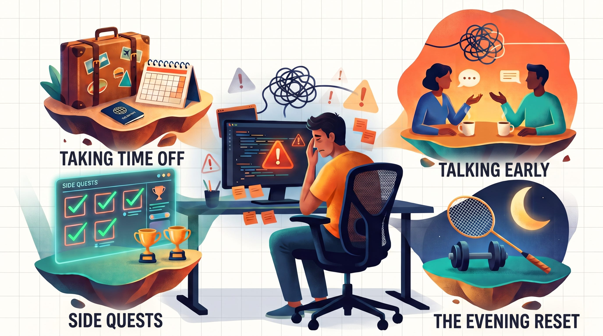

Most software engineers recognize this phase. Your code isn’t working. You’re spending hours debugging. You’re trying multiple approaches, but nothing clicks. Progress feels slow, or worse — uncertain. On its own, this isn’t burnout. But when this state persists, it often leads to burnout.

In my experience, burnout doesn’t start with long hours. It starts when you work hard for long enough without knowing whether you’re moving in the **right direction**.

You keep putting in effort, but the feedback loop stays weak. When results don’t match your energy, frustration builds.

Over the last five years of working as a software engineer at a big tech company, I’ve burned out multiple times. **This article covers:**

- **What burnout looks like in software engineering**
- **The four things I personally do to avoid it — or handle it**

## Why Burnout Is Common in Software Engineering

Burnout is common in software engineering largely because of how the work is structured, not because engineers are bad at managing stress.

### 1. Progress is often invisible

You can work for days without anything tangible to show for it. No merged code, no shipped feature, no user-facing change. The effort is real, but the progress is invisible. When progress is hard to see, it becomes difficult to tell whether you’re actually moving forward or just staying busy.

### 2. Problems are usually underspecified

Most non-trivial engineering work starts with vague requirements, conflicting constraints, and missing context. A significant part of the job is figuring out what the problem actually is before attempting to solve it. That requires engineers to hold many unresolved questions in their head at once — assumptions, trade-offs, edge cases, and unknowns. When this state persists without clear checkpoints, it becomes mentally draining. Burnout often begins here, not from writing code, but from **prolonged ambiguity**.

### 3. Feedback loops are slow

In many cases, you only learn whether a decision was correct after a launch, an incident, or delayed feedback on a pull request. Even PR feedback can take time to converge, sometimes leading to significant rewrites or a completely different approach. Slow feedback makes it harder to build confidence in your decisions. When outcomes are delayed or repeatedly revised, progress starts to feel fragile, and that **uncertainty accumulates**.

## How I Avoid and Handle Burnout

### 1. Taking Time Off (Short vs. Long)

Time off helps. Depending on how disengaged I feel, there are two types of time off.

- **Short, 3–4 days**  
  Usually long weekends. These help when I’m tired but still fundamentally engaged with the work. I still think about problems in the background, and ideas surface at random moments. When they do, I write them down — usually by messaging myself on Slack. There’s no pressure to act on them; the goal is simply to capture thoughts without context switching back into work.
- **Long, 2+ weeks**  
  These are for when I feel detached from work entirely. Long trips, visiting home, or anything that fully breaks routine tends to help here. This is especially useful after delivering a large project. Instead of immediately picking up the next ambiguous and complex task, stepping away creates enough distance to reset before resuming work.

### 2. Side Quests for Small Wins

When progress on the main problem stalls, burnout accelerates. One thing that helps me is briefly switching to **side quests**. By side quests, I mean:

- Updating documentation, dashboards, or metrics
- Clearing old backlog tasks or tickets
- Building internal debugging tools

These tasks are finite, have clear completion criteria, and produce visible impact quickly. In startups, the definition of a side quest changes, but the principle stays the same:

**Create small, guaranteed wins when the main path feels endless.**

### 3. Getting Unstuck by Talking Early

If I’m stuck for too long, thinking, researching, or debugging harder almost never helps. Instead, I rely on:

- 1:1s with peers or senior engineers
- Informal brainstorming sessions with co-workers
- Talking through assumptions out loud

A fresh perspective often reveals:

- A flawed mental model
- A hidden constraint
- A simpler solution I wasn’t seeing

These conversations usually help me see the problem differently and move forward faster than continuing to work alone. The goal isn’t to avoid hard work, but to apply it in the right direction.

### 4. The Evening Reset

This is for days where frustration is high, but not catastrophic. When I notice myself spiraling, I **hard-stop** instead of pushing through. My reset usually looks like:

- Gym, badminton, or any physical activity
- A 90-minute nap
- A shower
- Doing chores whilst listening to a podcast
- Or doing something spontaneous with friends

The common thread is disengaging mentally. After a full workday, decision fatigue is real, and both the brain and body need rest. **Doomscrolling does not help**; it usually makes things worse. Better alternatives include listening to a podcast, watching a movie or TV show, or reading something non-demanding. After that, I’ll resume work for **1–2 hours max**. Surprisingly often, something clicks.

## Recognizing the Pattern Early

Burnout rarely shows up all at once. It builds slowly when progress is unclear, friction stays high, and there are no reliable signals that you’re moving in the right direction.

For me, avoiding burnout isn’t about working less or caring less. It’s about noticing when effort and feedback stop lining up, and intervening early — before frustration turns into disengagement.
