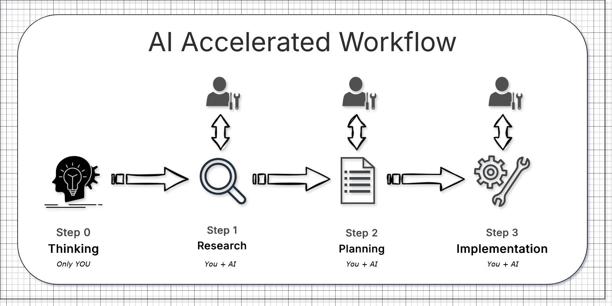

AI should be used to **accelerate your thinking**, not replace it. You are critical in the very first step — Step 0: Thinking.

This article is about how to use AI efficiently as a software engineer. It explains why AI “fails”, how “vibe coding” quietly accumulates technical debt, and why spec-driven development is the solution to these problems using a simple 4 step process.

There’ve been times when I relied too much on AI and let it figure out the problem statement itself. This never ends well. By the time I reached my 20th prompt trying to fix errors in the code it spewed out, I had already wasted more time than I saved. The result worked, but the solution was spaghetti code.

This is the trap: letting AI *discover* the problem instead of *solving* a problem you already understand. You may ship faster today, but you lose the ability to safely change systems tomorrow.

## The Problem

### The Infinite Software Crisis

AI does lower the cost of *doing* things. But it does **not** lower the cost of *understanding* them. In fact, it often raises it. When code can be generated faster than it can be understood, we enter what can be thought of as an **Infinite Software Crisis** — a modern version of the software crisis first identified in the late 1960s, now operating at machine speed.

Would highly recommend watching this video to learn more about the crisis — [https://www.youtube.com/watch?v=eIoohUmYpGI&t=113s](https://www.youtube.com/watch?v=eIoohUmYpGI&t=113s)

A key mistake we make when using AI is confusing **easy** with **simple**.

1. **Easy** means “close at hand”: copy-paste, generate, ship.
2. **Simple** means “untangled”: clear boundaries, single responsibilities, systems you can reason about.

AI-generated technical debt is a ticking time bomb. AI makes it easy to produce code, but it does nothing to make systems simple. By removing friction, it accelerates the accumulation of complexity. The code passes tests, deployments succeed — and yet the system becomes harder to understand and riskier to change. That’s how production failures are born.

### Vibe Coding fails

There was a study from MIT in August 2025. At the time, spec-driven development wasn’t widely discussed, and vibe coding was trending heavily. Many software engineers either didn’t adopt AI at all, or tried using it, got low-quality results, and eventually gave up.

This is one reason why, in Q3 and Q4 of 2025, AI failed to “replace” engineers in the way many companies expected. Several companies laid people off, only to rehire them months later after realizing that AI was overhyped and not delivering the outcomes they wanted. In practice, most teams were vibe coding and overusing chain-of-thought prompting without clear structure. You can read more about the MIT study here:

[https://fortune.com/2025/08/18/mit-report-95-percent-generative-ai-pilots-at-companies-failing-cfo/](https://fortune.com/2025/08/18/mit-report-95-percent-generative-ai-pilots-at-companies-failing-cfo/)

Long, iterative chats feel productive, but every clarification, pivot, and correction gets baked into the codebase. Dead code, conflicting patterns, and accidental complexity accumulate silently. This is why “just keep prompting until it works” scales so poorly. You don’t end up with a design. You end up with the history of every change you never properly planned. Chain-of-thought prompting works often, but spec-driven development works better. The most effective use of AI is not “generate code now,” but separating work into clear phases with clean boundaries.

## The Solution — Spec-driven development

Spec-driven development is a workflow where requirements, system design, and implementation steps are explicitly defined before writing code. The specification serves as the source of truth, and code is produced to conform to it rather than evolve through iterative trial-and-error.

When prompting AI, treat it like an **expert new-hire teammate**. A new hire is capable, but they don’t know your system, its history, constraints, or assumptions. If you don’t provide that context, the AI will fill in the gaps — often incorrectly.

YOU play an important role. During spec-driven development, the most important parts are the **human checkpoints between these phases**. Catching a wrong assumption (step 0) during research (step 1) or planning (step 2) prevents failures later. AI accelerates the mechanical work.

### Step 0: Thinking (Only YOU)

Think about the problem at hand. Write it down in a private, empty document. Don’t worry about formatting or spelling — AI can fix that later. Avoid writer’s block: just write down whatever is in your mind. Capture the problem statement, assumptions, and any relevant links (code links, wiki links, etc.). Then try to design a simple solution before involving AI.

This document becomes a crucial foundation, so make it as detailed as possible.

### Step 1: Research (You + AI)

Start with the document you created in **Step 0** and give AI all relevant context: design docs, service documentation, architecture diagrams, RFCs, and any important links. The goal here is not to write code, but to build a shared understanding of the system.

Use AI to explore the system, map dependencies, summarize architecture, and identify what will be affected by your change. Iterate on this process: correct misunderstandings and add missing context as needed.

The output of this step should be a single research artifact that clearly describes how the system works today. If you get this right, everything that follows becomes significantly easier.

### Step 2: Planning (You + AI)

Design the solution *before* implementation. Define clear boundaries, responsibilities, data flow, and explicit steps. This is the phase where human judgment matters most — because it prevents architectural mistakes that AI cannot see.

Think of this as reviewing a new hire’s first design document. Be critical. Question assumptions. Make changes now, while they’re cheap, instead of fixing spaghetti code later during implementation.

The goal is to arrive at a solid, well-reasoned plan with clear steps and known edge cases. Once this is done, implementation should feel straightforward and predictable.

### Step 3: Implementation (You + AI)

This is the simple part. With a clear plan in place, let AI execute the design and write the code. At this stage, the goal is execution — not invention.

Review the output to ensure it follows the plan exactly and doesn’t introduce new assumptions or patterns. If something feels unclear or unexpected, the issue is usually in the planning step, not the implementation.

## Spec-Driven Development using Kiro

Kiro IDE is a great way to do Spec-driven development. It follows the workflow in three files:

1. requirements.md — Captures user stories and acceptance criteria in structured EARS notation
2. design.md — Documents technical architecture, sequence diagrams, and implementation considerations
3. tasks.md — Provides a detailed implementation plan with discrete, trackable tasks

You can learn more about Kiro here: [https://kiro.dev/docs/specs/concepts/](https://kiro.dev/docs/specs/concepts/)

## Conclusion

To accelerate your thinking and work better with AI, I’d highly recommend Spec-Driven Development 4 step workflow as outlined in this article.

The hard part was never typing the code. It was knowing what to type.
